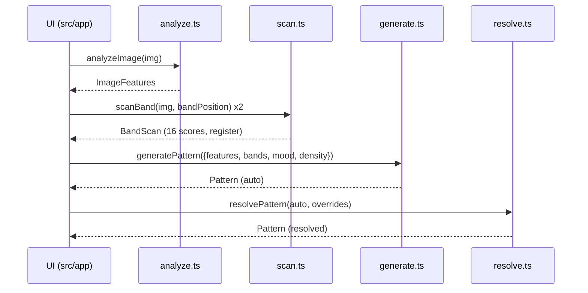
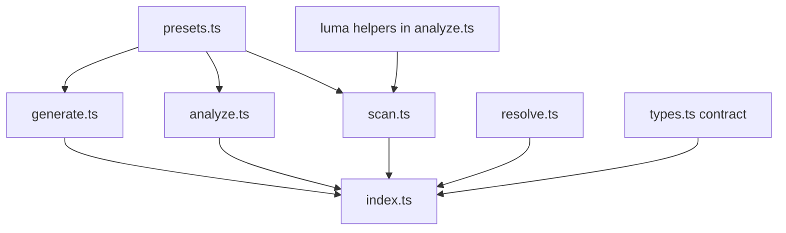

# Design Document: Pure Engine

## Overview

Replace the fixture-returning stubs in `src/engine/index.ts` with real implementations of `analyzeImage`, `scanBand`, `generatePattern` and `resolvePattern`. The engine is pure TypeScript: no DOM, no randomness, no I/O. It implements the contract in `src/engine/types.ts` without changing it, and follows README sections "Two scan bands", "Mood and density" and "Hard photos".

Conventions used throughout:

- Step indices are 0-based (0..15).
- When more than 6 cells qualify as accents in a band, keep the highest scores. Ties go to the lower step index.
- `src/fixtures/*.json` stay as example inputs. The engine does not have to reproduce their `pattern` exactly; fixture tests assert behaviour (see "Fixture Behaviour Testing"). `scripts/regen-fixtures.ts` rewrites the fixture patterns from the engine after tuning.
- All numeric tuning lives in `presets.ts` so it can be adjusted by ear without touching algorithms.

## Main Algorithm/Workflow



## Architecture

Four pure functions share constants from `presets.ts`. There is no shared mutable state.



## Components and Interfaces

| Component | Interface | Responsibility |
|---|---|---|
| `analyze.ts` | `analyzeImage(img): ImageFeatures` | Image-wide features, signal strength, mood suggestion |
| `scan.ts` | `scanBand(img, band): BandScan` | 16 normalized local-contrast scores for a band |
| `generate.ts` | `generatePattern(input): Pattern` | Base groove, accents, ghosts, cap, pitches |
| `resolve.ts` | `resolvePattern(auto, overrides): Pattern` | Apply user overrides on top of the auto pattern |
| `presets.ts` | constants and `MOODS` | Tuning values, scales, base grooves |

The signatures are specified in detail under "Key Functions with Formal Specifications".

## Data Models

The data models are the contract types in `src/engine/types.ts` (`ImageFeatures`, `BandPosition`, `BandScan`, `GenerateInput`, `Step`, `Pattern`, `Override`, `Overrides`). The only new model is `MoodPreset`, shown under "Core Interfaces/Types".

**Validation Rules:**
- Pattern tracks always have length 16.
- `Step.velocity` is one of 0, 0.45, 1 in generated patterns.
- Track B steps always carry a `pitch`.

## File Layout

```
src/engine/
  types.ts      (unchanged contract)
  presets.ts    constants: thresholds, moods, scales, base grooves
  analyze.ts    analyzeImage + luma helpers
  scan.ts       scanBand
  generate.ts   generatePattern
  resolve.ts    resolvePattern
  index.ts      re-exports types and the four functions (no fixtures import)
  *.test.ts     Vitest + fast-check
```

`index.ts` keeps `export * from './types'`. The local function exports shadow the `declare function` entries in `types.ts`.

## Core Interfaces/Types

`types.ts` is not modified. New internal types live in `presets.ts`:

```typescript
import type { MoodId, TrackId } from './types';

export interface MoodPreset {
  id: MoodId;
  bpm: number;
  rootPitchClass: number;            // 0..11, C = 0
  scaleOffsets: readonly number[];   // semitones above root, ascending, length 5
  baseOctaveForRegister(register: number): number;
  baseGroove(density: number): { kick: readonly number[]; clap: readonly number[] };
  bassLine: readonly number[];       // 16 scale-degree indices, each 0..4, index into scaleOffsets
  bNoteLength: number;               // length of a photo-driven B note
  drone: boolean;                    // step 0 of B holds a 16-step drone
}

export const DEFAULT_DENSITY = 50;
export const SIGNAL_FLOOR = 0.1;            // signalStrength below this silences A and B
export const MIN_CONTRAST_SPAN = 48;        // luma levels; scanBand never stretches a smaller span to 1
export const SCAN_EPS = 12;                 // luma levels; below this a band is flat and scores all 0
export const GHOST_VELOCITY = 0.45;
export const MAX_ACCENTS_PER_BAND = 6;
export const GHOST_MIN_DENSITY = 25;        // ghost notes are enabled from this density
export const accentThreshold = (d: number) => 0.8 - 0.3 * (d / 100);   // 0.80 .. 0.50
export const ghostThreshold  = (d: number) => 0.6 - 0.4 * (d / 100);   // 0.60 .. 0.20

export const MOODS: Record<MoodId, MoodPreset>;
export const TRACK_IDS: readonly TrackId[];
```

Preset values:

| | Hollow | Neon |
|---|---|---|
| bpm | 124 | 124 |
| root | D (2) | A (9) |
| scaleOffsets | [0, 3, 5, 7, 10] (D minor pentatonic: D F G A C) | [0, 3, 5, 7, 10] (A minor pentatonic: A C D E G) |
| base octave by register `r` | `r >= 0.5 → 2`, `0.25 <= r < 0.5 → 3`, `r < 0.25 → 4` | same |
| kick | density < 90: [0, 8]; density >= 90: [0, 6, 8, 14] | [0, 4, 8, 12] |
| clap | [12] | [4, 12] |
| bassLine (scale degrees, 0 = root, 3 = fifth) | [0,0,0,0, 0,0,3,0, 0,0,0,4, 0,0,3,0] | [0,3,0,3, 0,3,0,4, 0,3,0,3, 0,3,2,3] |
| bNoteLength | 1 (drone on step 0 has length 16) | 1 |
| drone | true | false |

The Hollow top-end kick pattern `[0, 6, 8, 14]` is a tuning choice. README only says "two hits a bar to four".

`bassLine` entries are indices into `scaleOffsets`, so every B pitch is in the mood's scale by construction. Hollow stays on the root with an occasional minor-pentatonic fifth (degree 3, A in D) or minor seventh (degree 4, C in D). Neon alternates root and fifth with a few colour tones (degree 4 at step 7, degree 2 at step 14). The arrays are tuning values chosen by ear and live only in `presets.ts`.

## Key Functions with Formal Specifications

### analyzeImage()

```typescript
export function analyzeImage(img: ImageData): ImageFeatures
```

**Preconditions:**
- `img.data.length === img.width * img.height * 4`

**Postconditions:**
- Every numeric field is in `[0, 1]`.
- Empty image (`width * height === 0`) returns all zeros, `suggestedMood: 'hollow'`.
- Pure: same pixels give the same result; `img` is not mutated.
- A fully black image has `signalStrength < SIGNAL_FLOOR`.
- iid noise images of at least 256 pixels have `signalStrength < SIGNAL_FLOOR`.

**Loop Invariants:**
- Histogram loop: `hist` counts the luma of exactly the pixels visited so far.

### scanBand()

```typescript
export function scanBand(img: ImageData, band: BandPosition): BandScan
```

**Preconditions:**
- `img` is a valid `ImageData`.
- `band.center` and `band.height` are finite (values outside `[0, 1]` are clamped).

**Postconditions:**
- `scores.length === 16` and every score is in `[0, 1]`.
- `register === clamp(band.center, 0, 1)`.
- If no cell stands out (`dmax < SCAN_EPS`), all scores are 0.
- Otherwise the maximum score is `dmax / max(dmax, MIN_CONTRAST_SPAN)`: exactly 1 when the band's local contrast is at least `MIN_CONTRAST_SPAN`, and below 1 for weaker contrast.
- A band whose cells all lie within a luma range under `MIN_CONTRAST_SPAN` (empty night sky with noise or a gentle gradient) never reaches `accentThreshold(100) = 0.5`, so it produces no accents at any density.
- Pure and deterministic.

### generatePattern()

```typescript
export function generatePattern(input: GenerateInput): Pattern
```

**Preconditions:**
- `input.bands.A.scores` and `input.bands.B.scores` have length 16 (missing or non-finite entries count as 0).
- `input.density` is clamped to `[0, 100]` internally.

**Postconditions:**
- `pattern.mood === input.mood`, `pattern.bpm === MOODS[mood].bpm`.
- Every track has exactly 16 steps.
- `kick` and `clap` come from the mood's base groove and never depend on the photo.
- If `features.signalStrength < SIGNAL_FLOOR`, every step of A and B has velocity 0.
- At most 6 steps with velocity 1 on each of A and B.
- Every B step has a `pitch` whose pitch class belongs to the mood's scale (`rootPitchClass + scaleOffsets`), including silent steps. This holds because each pitch is `pool[bassLine[i]]` with `bassLine[i]` in 0..4.
- Same input gives a deeply equal output.

### resolvePattern()

```typescript
export function resolvePattern(auto: Pattern, overrides: Overrides): Pattern
```

**Preconditions:**
- `auto` is a valid pattern.

**Postconditions:**
- Returns a new object; `auto` and `overrides` are not mutated.
- For each valid override (known track, integer step 0..15, value `'on'` or `'off'`): `'on'` gives `velocity === 1`, `'off'` gives `velocity === 0`.
- `pitch` is preserved for both. `'off'` drops `length`. `'on'` keeps an existing `length`.
- Every step without a valid override is deeply equal to the auto step.
- `bpm` and `mood` are unchanged.

## Algorithmic Pseudocode

### analyzeImage

```pascal
ALGORITHM analyzeImage(img)
INPUT: img of type ImageData
OUTPUT: features of type ImageFeatures

BEGIN
  n ← img.width * img.height
  IF n = 0 THEN RETURN {0, 0, 0, 0, 'hollow'} END IF

  // Integer luma, deterministic: (77r + 150g + 29b) >> 8
  FOR p FROM 0 TO n - 1 DO
    luma[p] ← (77*r + 150*g + 29*b) >> 8
    hist[luma[p]] ← hist[luma[p]] + 1
    IF max(r,g,b) > 0 THEN satSum ← satSum + (max - min) / max END IF
  END FOR

  saturation ← satSum / n

  p1, p5, p50, p95, p99 ← percentiles(hist, n)      // smallest v with cumulative count >= ceil(q*n)
  contrast   ← clamp((p95 - p5) / 255, 0, 1)

  // detail: share of pixels with a strong horizontal or vertical luma step
  edges ← count of pixels where |luma[p] - luma[right]| > 24 OR |luma[p] - luma[below]| > 24
  detailDensity ← clamp(4 * edges / n, 0, 1)

  // signal strength on the raw image
  spread     ← p99 - p1
  structure  ← clamp(spread / 24, 0, 1)
  medDx      ← median of |luma[p] - luma[p+1]| over horizontal neighbours (0 if width = 1)
  noiseRatio ← medDx / max(p95 - p5, 1)
  noisePen   ← clamp((noiseRatio - 0.08) / 0.12, 0, 1)
  signalStrength ← structure * (1 - noisePen)

  moodScore ← 0.45*saturation + 0.30*contrast + 0.25*detailDensity
  suggestedMood ← IF moodScore >= 0.5 THEN 'neon' ELSE 'hollow'

  RETURN features
END
```

**Why these choices:**
- Black: `spread = 0`, so `structure = 0`.
- Dark with contrast: a door gap of light gives a large `p99 - p1`, so signal stays high. Absolute brightness is not used.
- Noise: uncorrelated neighbours give `medDx / (p95 - p5)` of about 0.25 to 0.3, which drives `noisePen` to 1. Natural and blurry photos sit below 0.08.
- Fixture check: `emptyLot` moodScore is 0.30 (hollow), `neonStreet` is 0.81 (neon), `blackImage` is 0 (hollow).

### scanBand

```pascal
ALGORITHM scanBand(img, band)
INPUT: img, band
OUTPUT: scan of type BandScan

CONSTANT EPS ← SCAN_EPS (12)                 // luma levels; below this a band is considered flat
CONSTANT SPAN ← MIN_CONTRAST_SPAN (48)       // luma levels; minimum divisor for normalisation

BEGIN
  W ← img.width; H ← img.height
  center ← clamp(band.center, 0, 1); height ← clamp(band.height, 0, 1)
  IF W = 0 OR H = 0 THEN RETURN {scores: 16 zeros, register: center} END IF

  top    ← clamp(round((center - height/2) * H), 0, H - 1)
  bottom ← clamp(round((center + height/2) * H), top + 1, H)   // exclusive, at least one row

  FOR i FROM 0 TO 15 DO
    x0 ← floor(i * W / 16)
    x1 ← max(floor((i + 1) * W / 16), x0 + 1)     // at least one column
    x0 ← min(x0, W - 1); x1 ← min(x1, W)
    values ← luma of pixels in [x0, x1) x [top, bottom)
    sort values descending
    k ← max(1, ceil(0.1 * length(values)))
    peak[i] ← mean(values[0 .. k-1])               // brightest decile of the cell
  END FOR

  m ← median(peak)                                  // mean of the 8th and 9th smallest
  FOR i FROM 0 TO 15 DO d[i] ← max(0, peak[i] - m) END FOR
  dmax ← max(d)

  IF dmax < EPS THEN scores ← 16 zeros
  ELSE scores[i] ← d[i] / max(dmax, SPAN)
  RETURN {scores, register: center}
END
```

**Loop Invariants:**
- Cell loop: `peak[0..i-1]` are computed from disjoint column ranges inside the band rows.

**Notes:**
- Only local contrast inside the band is used, so a dark photo with one bright gap (d of 48 or more) still scores 1.0 on that cell. A streetlight or lit door gap is far above 48 luma levels over the band median.
- Dividing by `max(dmax, SPAN)` keeps weak contrast weak. Noise of ±6 luma gives `dmax <= 12`, which is either flat (all 0) or at most 12/48 = 0.25, below `accentThreshold(100) = 0.5`. A sky gradient spanning under 48 luma levels has `d <= ` half its span, so scores stay under 0.5. An accent at density 100 needs `d >= 24`, and at density 50 needs `d >= 31.2`.
- A blurry neon blob raises the peak of its cells above the band median, so it reads.
- Using the decile peak (not the mean) keeps a small light inside a wide cell from being diluted.

### generatePattern

```pascal
ALGORITHM generatePattern(input)
INPUT: input of type GenerateInput
OUTPUT: pattern of type Pattern

BEGIN
  mood ← MOODS[input.mood]
  d ← clamp(input.density, 0, 100)
  live ← input.features.signalStrength >= SIGNAL_FLOOR

  groove ← mood.baseGroove(d)
  kick ← steps16(groove.kick, velocity 1)
  clap ← steps16(groove.clap, velocity 1)

  A ← bandVelocities(input.bands.A.scores, d, live, cap = 6, skip = none)
  A_track ← map v IN A TO {velocity: v}

  droneOn ← mood.drone AND live
  B_vel ← bandVelocities(input.bands.B.scores, d, live,
                         cap = 6 - (1 IF droneOn ELSE 0),
                         skip = (0 IF mood.drone ELSE none))
  IF droneOn THEN B_vel[0] ← 1 END IF

  base ← mood.baseOctaveForRegister(input.bands.B.register)
  pool ← [midi(root, base) + offset FOR offset IN mood.scaleOffsets]   // 5 ascending pitches
  FOR i FROM 0 TO 15 DO
    pitch ← pool[mood.bassLine[i]]                                    // degree 0..4 from the mood's bass line
    step ← {velocity: B_vel[i], pitch: name(pitch)}
    IF i = 0 AND droneOn THEN step.length ← 16
    ELSE IF NOT mood.drone THEN step.length ← mood.bNoteLength
    ELSE IF B_vel[i] > 0 THEN step.length ← mood.bNoteLength
    B_track[i] ← step
  END FOR

  RETURN {bpm: mood.bpm, mood: input.mood, tracks: {kick, clap, A: A_track, B: B_track}}
END
```

```pascal
ALGORITHM bandVelocities(scores, d, live, cap, skip)
INPUT: scores[16], density d, live flag, accent cap, optional skipped step
OUTPUT: vel[16] with values in {0, 0.45, 1}

BEGIN
  vel ← 16 zeros
  IF NOT live THEN RETURN vel END IF

  tAcc ← accentThreshold(d); tGhost ← ghostThreshold(d)
  ghostsOn ← d >= GHOST_MIN_DENSITY

  candidates ← [i FOR i IN 0..15 WHERE i ≠ skip AND scores[i] >= tAcc]
  sort candidates by (score DESC, index ASC)
  accents ← first cap entries of candidates
  overflow ← remaining entries

  FOR i IN accents DO vel[i] ← 1 END FOR
  IF ghostsOn THEN
    FOR i IN overflow DO vel[i] ← 0.45 END FOR
    FOR i IN 0..15 WHERE i ≠ skip AND vel[i] = 0 AND scores[i] >= tGhost DO vel[i] ← 0.45 END FOR
  END IF
  RETURN vel
END
```

**Preconditions:**
- `scores` has 16 finite entries (non-finite entries are replaced by 0 before this step).

**Postconditions:**
- `count(vel[i] = 1) <= cap`.
- Accent set is the `cap` best-scoring qualifying cells; equal scores keep the lower index.
- Determinism: the sort key is total, so no tie is left to the sort implementation.

**Loop Invariants:**
- After each iteration of the accent loop, `vel` holds only values from `{0, 1}`.
- After the ghost loop, no step that was an accent changed value.

**Monotonic density argument:** `tAcc` and `tGhost` only decrease as `d` grows, and `ghostsOn` only turns on. The qualifying set is a score threshold set, so cells added at higher density have strictly lower scores than every existing member. The top-`cap` accents therefore stay the same, and a step never loses velocity: 0 may become 0.45 or 1, and 0.45 may become 1.

### resolvePattern

```pascal
ALGORITHM resolvePattern(auto, overrides)
INPUT: auto, overrides
OUTPUT: resolved of type Pattern

BEGIN
  resolved ← deep copy of auto
  FOR each trackId IN TRACK_IDS DO
    perTrack ← overrides[trackId]
    IF perTrack IS UNDEFINED THEN CONTINUE END IF
    FOR each (key, value) IN perTrack DO
      i ← integer value of key
      IF i NOT IN 0..15 OR value NOT IN {'on', 'off'} THEN CONTINUE END IF
      step ← resolved.tracks[trackId][i]
      IF value = 'on' THEN step.velocity ← 1
      ELSE step.velocity ← 0; delete step.length
    END FOR
  END FOR
  RETURN resolved
END
```

**Loop Invariants:**
- Steps not named by a valid override are never written.

## Example Usage

```typescript
const img = canvasCtx.getImageData(0, 0, w, h);          // UI downsampled to 256 wide
const features = analyzeImage(img);
const bands = {
  A: scanBand(img, { center: 0.35, height: 0.12 }),
  B: scanBand(img, { center: 0.75, height: 0.12 }),
};
const auto = generatePattern({ features, bands, mood: features.suggestedMood, density: 50 });
const resolved = resolvePattern(auto, { A: { 3: 'on' }, kick: { 8: 'off' } });
```

## Correctness Properties

Each is a fast-check property in `src/engine/engine.properties.test.ts`. Shared arbitraries: `imageArb` (width 16..48, height 4..24, random RGBA with alpha 255), `blackImageArb` (channels 0..2), `noiseImageArb` (iid uniform channels, at least 256 pixels), `bandPositionArb`, `scoresArb` (16 floats in `[0, 1]`), `featuresArb`, `moodArb`, `densityArb` (integers 0..100), `overridesArb`.

### Property 1: Determinism

**Validates: Requirements 9.1, 9.2**

**Determinism.** For all inputs, `analyzeImage(img)`, `scanBand(img, b)` and `generatePattern(i)` called twice return deeply equal values. `resolvePattern` also leaves its arguments unchanged (checked with a deep clone before the call).
### Property 2: Dark-safe

**Validates: Requirements 2.1, 2.2, 7.1, 7.2**

**Dark-safe.** For black or noise images: `features.signalStrength < SIGNAL_FLOOR`, and for any mood, density and band scores, `generatePattern` returns velocity 0 on every step of A and B and the same kick and clap as a normal image of that mood and density.
### Property 3: Monotonic density

**Validates: Requirements 4.5**

**Monotonic density.** For `d1 <= d2` and the same other inputs, every step of A and B has `velocity(d2) >= velocity(d1)`.
### Property 4: Capped

**Validates: Requirements 4.3, 4.4, 6.5**

**Capped.** For all inputs, `tracks.A` and `tracks.B` each contain at most 6 steps with velocity 1. A second example test feeds 16 equal scores of 1.0 and checks that steps 0..5 are the accents (lower index wins ties) on band A.
### Property 5: In key

**Validates: Requirements 6.1**

**In key.** For all inputs, the pitch class of every `tracks.B[i].pitch` (all 16 steps) is in `{(root + o) % 12 for o in scaleOffsets}` for the mood.
### Property 6: Overrides win

**Validates: Requirements 8.1, 8.2, 8.3, 8.5**

**Overrides win.** For all patterns from `generatePattern` and all overrides, every valid `'on'` step has velocity 1, every valid `'off'` step has velocity 0, and every other step is deeply equal to the auto step. `pitch` stays equal on overridden steps.

## Error Handling

### Invalid or degenerate image

**Condition:** zero width or height, or `data.length` shorter than `width * height * 4`.
**Response:** `analyzeImage` returns all-zero features; `scanBand` returns 16 zeros.
**Recovery:** the engine falls back to the base groove (signal below floor).

### Non-finite numbers

**Condition:** `NaN` or `Infinity` in `band.center`, `band.height`, `density`, or scores.
**Response:** band values and density are clamped, with non-finite treated as 0 for scores and 0.5 for band geometry; density non-finite becomes `DEFAULT_DENSITY`.
**Recovery:** none needed; output stays valid.

### Bad overrides

**Condition:** unknown track key, step outside 0..15, non-integer step, or value other than `'on'`/`'off'`.
**Response:** the entry is ignored.
**Recovery:** none needed.

## Testing Strategy

### Unit Testing Approach

- `analyze.test.ts`: black image gives signal below floor; a dark image with one bright door gap keeps signal above floor; a saturated bright image suggests `neon`, a grey one suggests `hollow`; empty image returns zeros.
- `scan.test.ts`: a lone bright cell in column 11 (at least 48 luma above the rest) gives score 1 at index 11 and zeros elsewhere; a flat band gives zeros; a band containing only ±6 luma noise gives all scores below `accentThreshold(100)`; a band over a dim gradient under 48 luma levels wide gives all scores below `accentThreshold(100)`; band moved vertically changes the scores; `register` echoes the clamped center.
- `generate.test.ts`: Hollow clap is exactly step 12, Neon clap is steps 4 and 12, B pitches follow `bassLine` for both moods, tie-break example, ghost-note gating at density 24 vs 25, Hollow kick at density 89 vs 90, register octave mapping, drone presence and its absence when signal is low.
- `resolve.test.ts`: `'on'` keeps pitch and length, `'off'` drops length, out-of-range entries ignored.

### Fixture Behaviour Testing

`fixtures.test.ts` imports `emptyLot`, `neonStreet` and `blackImage` from `src/fixtures`, runs `generatePattern({ features, bands, mood: features.suggestedMood, density: 50 })` on each, and asserts behaviour instead of deep equality with `fixture.pattern`:

- `emptyLot`: band A has exactly one step with velocity 1, at index 11, and no other A step above 0 (the fixture scores are 0.9 at index 11 and 0.1 elsewhere).
- `blackImage`: every A and B step has velocity 0.
- `neonStreet`: the count of A and B steps with velocity above 0 is greater than the same count for `emptyLot`.

The engine itself never imports `src/fixtures`.

### Fixture Regeneration Script

`scripts/regen-fixtures.ts` reads each fixture JSON in `src/fixtures`, recomputes `pattern` with `generatePattern` (density `DEFAULT_DENSITY`, mood from `features.suggestedMood`), and writes the file back with only `pattern` changed. Run it after tuning presets so the fixture patterns stay current for the UI. It is a Node script and is not part of the engine bundle. It is not run by tests.

### Property-Based Testing Approach

**Property Test Library**: fast-check with Vitest, minimum 100 runs per property.

### Integration Testing Approach

One end-to-end test builds a synthetic `ImageData`-shaped object (`{ width, height, data: Uint8ClampedArray }`, since Vitest runs without a DOM) with a bright block under band A, runs the four functions, and checks that the matching A step is an accent.

## Performance Considerations

Analysis runs on a 256-wide image, so about 50k to 100k pixels. One pass builds the luma array and histogram, a second pass counts edges and horizontal differences. `scanBand` touches only the band rows and runs on every band drag, so it uses one pass per cell with a small sort (cell size is at most about 16 x 30 pixels). Median of horizontal differences uses a 256-bin histogram, not a sort.

## Security Considerations

The engine reads pixel data only. Photos never leave the machine and the engine performs no I/O. Inputs are clamped, and array indexes are always bounded by 16 or by image size.

## Dependencies

- Runtime: none (pure TypeScript).
- Dev: Vitest and fast-check, both already in `package.json`. `scripts/regen-fixtures.ts` needs a TypeScript runner for Node (for example `tsx`); if it is not installed, adding it as a dev dependency is part of the implementation.
- Existing: `src/engine/types.ts` (not modified), `src/fixtures` (tests only).

## Open Assumptions

- `DEFAULT_DENSITY = 50` is used by the fixture tests and the regeneration script. The UI default is not set in the contract.
- Signal "fade" from README is implemented as a hard gate at `SIGNAL_FLOOR`. The fixtures show a clean cut (signal 0.02 gives silence), and a gradual fade would need a velocity scale that the contract does not carry.
- Scale, BPM and thresholds are placeholders for tuning by ear. They are constants in `presets.ts`.
