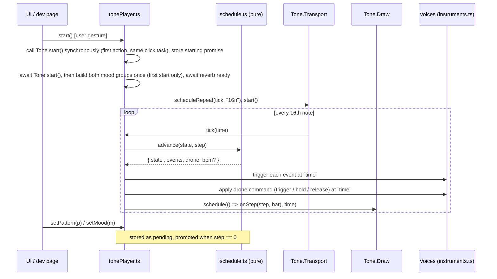
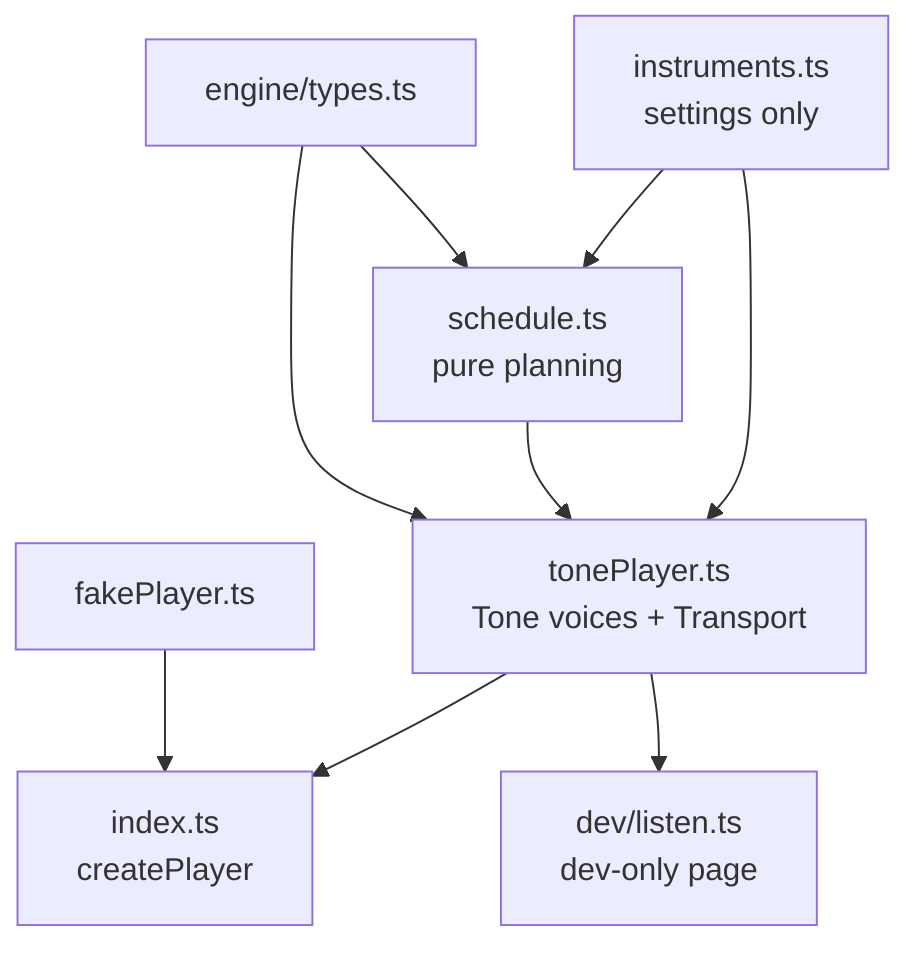

# Design Document: Real Audio Player

## Overview

Replace the silent `createFakePlayer` behind `createPlayer` with a Tone.js player that implements the `Player` contract in `src/engine/types.ts` without changing it. `createFakePlayer` stays exported for tests. The player runs `Tone.Transport` at the pattern's bpm as a 16-step loop of 16th notes, swaps pattern and mood only at bar boundaries, fires `onStep` through `Tone.Draw`, and plays synthesized instruments (no sample files).

Conventions used throughout:
- Language is TypeScript (the repo is Vite + React + TS).
- Step indices are 0-based (0..15).
- All sound settings live in `src/audio/instruments.ts` as plain data, so they can be tuned by ear without touching logic. That file has no runtime Tone import, so Vitest can import it in Node.
- The per-step scheduling decision is a pure function in `src/audio/schedule.ts` (no Tone, no DOM, no randomness) and is unit-tested. Only `tonePlayer.ts` touches Tone.
- `src/audio` must not import from `src/ui` or `src/app`.
- The Hollow drone is sustained across bars: `schedule.ts` tracks the pitch that is sounding and emits a `trigger`, `hold` or `release` command, so `tonePlayer.ts` holds no musical decisions.
- `start()` calls `Tone.start()` synchronously as its first action, before any `await` and before building anything, so the browser counts it as part of the user's click gesture. Groups are built and reverbs awaited only after `Tone.start()` has been called and resolved.
- Mood groups are never disposed during playback. Both the Hollow and Neon groups are built once in `start()` and kept for the player's lifetime. A mood switch releases the old group's voices at the bar line and leaves its reverb connected, so the tail rings out. Both groups are disposed only by an explicit final `dispose()`.

## Main Algorithm/Workflow



## Architecture



Files:

| File | Role |
| --- | --- |
| `src/audio/instruments.ts` | Every tunable number: gain curve, kick, clap, per-mood A and B voices, reverb, master. No Tone import. |
| `src/audio/schedule.ts` | Pure: `velocityToGain`, `voiceFor`, `planStep`, `planDrone`, `queuePattern`, `queueMood`, `advance`, `stopState`. Tracks the sounding drone pitch. |
| `src/audio/schedule.test.ts` | Unit tests for the above. |
| `src/audio/tonePlayer.ts` | `createTonePlayer(): TonePlayer`, where `TonePlayer = Player & { dispose(): void }`. Owns Tone objects, Transport, Draw, listeners. |
| `src/audio/index.ts` | `createPlayer` is `createTonePlayer` typed as `() => Player`, so the contract is unchanged. Also exports `createTonePlayer` and `TonePlayer` for callers that need `dispose()`. Still re-exports `createFakePlayer`, `FAKE_BPM`, `FakePlayer`. |
| `dev/listen.html`, `dev/listen.ts` | Dev-only listening page (owned by Frank, outside `src/`). |

## Components and Interfaces

### Component 1: instruments.ts (sound settings)

**Purpose**: One place to tune by ear. Plain data only.

```ts
export type VoiceId =
  | 'kick' | 'clap'
  | 'hollowMetal' | 'neonHat'
  | 'hollowDrone' | 'hollowBass' | 'neonBass';

/** velocity (0..1) -> gain (0..1) is gain = velocity ** VELOCITY_CURVE. */
export const VELOCITY_CURVE = 1.6;          // ghost 0.45 -> 0.28 (about -11 dB vs accent)
export const DRONE_MIN_STEPS = 16;          // Hollow B note with length >= this uses the drone voice
export const GATE = 0.9;                    // fraction of a note's length that is held before release

export const MASTER = { volumeDb: -6, limiterThresholdDb: -1 };
export const LOOKAHEAD_S = 0.05;            // Transport start offset

export const KICK = {
  note: 'C1',
  synth: { pitchDecay: 0.05, octaves: 6, oscillator: { type: 'sine' },
           envelope: { attack: 0.001, decay: 0.35, sustain: 0, release: 0.1 } },
  volumeDb: 0,
};
export const CLAP = {
  synth: { noise: { type: 'white' }, envelope: { attack: 0.001, decay: 0.15, sustain: 0, release: 0.05 } },
  filter: { type: 'bandpass', frequency: 1800, Q: 0.8 },
  volumeDb: -4,
};
export const HOLLOW_METAL = {                // track A, Hollow
  synth: { harmonicity: 5.1, modulationIndex: 24, resonance: 3000, octaves: 1.2,
           envelope: { attack: 0.001, decay: 1.2, release: 1.5 } },
  frequency: 220, duration: 0.4, volumeDb: -16,
  reverb: { decay: 5, preDelay: 0.02, wet: 0.6 },   // long tail
};
export const NEON_HAT = {                    // track A, Neon
  synth: { harmonicity: 5.1, modulationIndex: 32, resonance: 7000, octaves: 1.5,
           envelope: { attack: 0.001, decay: 0.05, release: 0.02 } },
  frequency: 400, duration: 0.03, volumeDb: -18,
};
export const HOLLOW_DRONE = {                // track B, Hollow, notes with length >= DRONE_MIN_STEPS; held with triggerAttack, ended with triggerRelease
  synth: { oscillator: { type: 'sawtooth' },
           envelope: { attack: 0.8, decay: 0.2, sustain: 0.9, release: 1.5 },
           filter: { Q: 2, type: 'lowpass', rolloff: -24 }, filterEnvelope: { /* ... */ } },
  volumeDb: -14,
};
export const HOLLOW_BASS = {                 // track B, Hollow, short notes
  synth: { oscillator: { type: 'triangle' },
           envelope: { attack: 0.005, decay: 0.2, sustain: 0.3, release: 0.2 } },
  volumeDb: -8,
};
export const NEON_BASS = {                   // track B, Neon
  synth: { oscillator: { type: 'square' },
           envelope: { attack: 0.005, decay: 0.12, sustain: 0.2, release: 0.08 },
           filter: { Q: 3, type: 'lowpass', rolloff: -12 },
           filterEnvelope: { attack: 0.005, decay: 0.1, sustain: 0.1, release: 0.08,
                             baseFrequency: 200, octaves: 3 } },
  volumeDb: -8,
};
```

Values above are starting points. They are not final and are expected to change when tuned by ear. The exact option objects follow the Tone 15 option types for `MembraneSynth`, `NoiseSynth`, `MetalSynth`, `Synth` and `MonoSynth`.

### Component 2: schedule.ts (pure scheduling)

**Purpose**: Decide, for a given step, which voices play with which gain, pitch and length, and when pending changes take effect. No Tone, no time, no side effects.

```ts
import type { MoodId, Pattern, TrackId } from '../engine/types';
import type { VoiceId } from './instruments';

export interface NoteEvent {
  track: TrackId;
  voice: VoiceId;
  gain: number;          // 0..1, = velocityToGain(step.velocity)
  pitch?: string;        // track B only
  lengthSteps: number;   // >= 1; 1 for percussion
}

export interface ScheduleState {
  pattern: Pattern | null;      // in effect now
  mood: MoodId | null;          // in effect now
  pendingPattern: Pattern | null;
  pendingMood: MoodId | null;
  drone: string | null;         // pitch of the Hollow drone currently sounding, or null
}

/** What the player must do with the single Hollow drone voice at this step. */
export type DroneCommand =
  | { action: 'none' }                                   // nothing sounding, nothing to start
  | { action: 'trigger'; pitch: string; gain: number }   // start, or re-attack on a new pitch
  | { action: 'hold' }                                   // same pitch already sounding: do nothing
  | { action: 'release' };                               // end the sounding drone

export interface Advance {
  state: ScheduleState;
  events: NoteEvent[];          // never contains a hollowDrone event; the drone is in `drone`
  drone: DroneCommand;
  bpm?: number;                 // set only when a pending pattern was promoted at step 0
}

export const initialState: ScheduleState;
export function velocityToGain(velocity: number): number;
export function voiceFor(track: TrackId, mood: MoodId, lengthSteps: number): VoiceId;
export function planStep(pattern: Pattern, mood: MoodId, step: number): NoteEvent[];
export function planDrone(pattern: Pattern, mood: MoodId, step: number): { pitch: string; gain: number } | null;
export function barHasDrone(pattern: Pattern, mood: MoodId): boolean;
export function queuePattern(s: ScheduleState, p: Pattern, running: boolean): ScheduleState;
export function queueMood(s: ScheduleState, m: MoodId, running: boolean): ScheduleState;
export function advance(s: ScheduleState, step: number): Advance;
export function stopState(s: ScheduleState): ScheduleState;   // clears `drone`, keeps pattern, mood and pending
```

**Responsibilities**:
- `queuePattern` and `queueMood` store a pending value. When the transport is not running they apply at once, as `createFakePlayer` does.
- `queuePattern(p)` also sets the pending mood to `p.mood`. The most recent call to `setPattern` or `setMood` wins, so a mood toggle followed by the pattern regenerated for that mood stays consistent.
- `advance` promotes pending values only when `step === 0`, so nothing changes mid-bar.
- `planStep` skips drone notes (Hollow B with length >= `DRONE_MIN_STEPS`). `planDrone` reports them, and `advance` compares the pitch with `state.drone` to produce the `DroneCommand`:
  - Same pitch already sounding: `hold`. The note is not retriggered, so the drone sustains across bars. The held note's velocity is ignored.
  - Different pitch, or nothing sounding: `trigger`, and `state.drone` becomes that pitch.
  - At step 0, a drone is sounding but the bar has no drone note at any step (`barHasDrone` is false), for example when the signal drops: `release`, and `state.drone` becomes null.
  - The effective mood changes at step 0 while a drone is sounding (the new mood has no drone voice): `release`, and `state.drone` becomes null. Coming back to Hollow later finds `state.drone === null`, so the drone retriggers.
- `stopState` clears `drone` so the first bar after `start()` always triggers. The player calls it from `stop()`.

### Component 3: tonePlayer.ts (Tone integration)

**Purpose**: Implement `Player` with Tone.

```ts
export type TonePlayer = Player & {
  /** Final teardown. Disposes both mood groups and the shared voices. Not part of the Player contract. */
  dispose(): void;
};
export function createTonePlayer(): TonePlayer;
```

`Player` in `src/engine/types.ts` has no `dispose` (it has `start`, `stop`, `setPattern`, `setMood`, `onStep`), and the contract stays unchanged. `dispose()` is therefore kept off `Player` and exposed only through the concrete `TonePlayer` return type of `createTonePlayer`, which `src/audio/index.ts` also exports. `createPlayer` stays typed `() => Player`, so Sunny's code never sees `dispose`. The dev page and tests call `createTonePlayer()` when they need teardown.

**Responsibilities**:
- Voices are grouped into one **group** per mood (Hollow and Neon). A group owns that mood's synths, its effects (Hollow: `Tone.Reverb`) and its output gain, all routed to a shared `Tone.Limiter` then `Tone.Destination` (volume from `MASTER`). Each voice has its own `volume` from `instruments.ts`. Clap goes through a bandpass `Tone.Filter`. The kick and clap belong to a shared group.
- Group lifecycle: both mood groups and the shared group are built exactly once, in `start()`, and live until `dispose()`. There is no retiring, disposing or rebuilding state. Groups are never disposed by a mood switch, by `stop()`, or by a restart.
- `start()` is a plain (non-`async`) function so that nothing can run before `Tone.start()`. Browsers only allow the audio context to resume while the click's user activation is live, so `Tone.start()` must be called synchronously, as the first audio action, in the same task as the click. In order:
  1. Synchronously, with no `await` before it: if disposed, return a rejected promise (a plain check, no await). If a `starting` promise exists, return it (the first call already called `Tone.start()` in this gesture, so nothing is skipped or reordered). If the player is already running, return a resolved promise.
  2. Synchronously, still before any `await`: `const toneReady = Tone.start()`. This is called on every non-deduplicated `start()`, including a restart after `stop()` (it is idempotent and resumes a suspended context). If `Tone.start()` throws synchronously, convert that to a rejected promise.
  3. Synchronously: `starting = run(toneReady)` and `return starting`. `run` is an async function, so its body executes up to its first `await` immediately, but the promise is assigned to `starting` before `start()` returns to the caller. A second `start()` call in the same gesture therefore always sees `starting` set.
  4. Inside `run`: `await toneReady`. Only after it resolves, if the groups do not exist yet (first start), build the shared group, the Hollow group and the Neon group, then `await Promise.all([hollowReverb.ready, ...])` (for `Tone.Reverb`, `ready` resolves after the impulse response is generated; call `generate()` explicitly if the installed Tone version does not generate on construction). If the groups already exist (restart after `stop()`), skip building.
  5. Set `Transport.bpm.value` from the active pattern, schedule `Transport.scheduleRepeat(tick, '16n', 0)` once, then `Transport.start('+LOOKAHEAD_S')`.
  6. In a `finally`, clear `starting` (on success and on failure), so a later call after a rejection starts again and calls `Tone.start()` first.
  - If `Tone.start()` rejects, `run` rethrows before step 4's build: no group is created, no Transport work happens, and the player stays stopped. A later `start()` from a new click tries again.
  - If building fails after `Tone.start()` resolved, `start()` rejects, the partially built groups are disposed, and the next `start()` builds from scratch (after calling `Tone.start()` first again).
  - A `start()` after `dispose()` rejects with an error (the player is unusable after teardown).
- **No await before `Tone.start()` (click-handler rule)**: nothing in the call path from the click event to `Tone.start()` may `await`, or otherwise yield (no `setTimeout`, no `.then` hop, no image or engine work first). This applies to `start()` itself and to every caller, including the app's Play handler and `dev/listen.ts`. Work the player needs before playing (`setPattern`, `setMood`) is done synchronously or earlier, not in front of `player.start()` with an `await`.
- `tick(time)`: call `advance(state, step)`, set `Transport.bpm.value` if `bpm` is returned, trigger each event at `time` on the group of the effective mood, apply `result.drone` at `time` (see drone mapping below), then `Tone.getDraw().schedule(() => emit(step, bar), time)`, then increment step (wrap at 16 and increment bar).
- Mood switch (the effective mood after `advance` differs from the one before, which can only happen at step 0): `releaseGroup(oldMood, time)` calls `triggerRelease(time)` on the old group's sustained voices (the Hollow drone) so they fade through their own release envelopes. Nothing is stopped, disconnected or disposed. The old group's `Reverb` stays connected, so its tail rings out on its own and mixes under the new mood. Percussive voices need no call because they end by their own envelopes. The new mood's group is already built and ready, so no bar is dropped and no timer is involved.
- `stop()`: `Transport.stop()`, `Transport.cancel()`, `Draw.cancel()`, `triggerRelease()` on all sustained voices (releases, not hard stops), reset step and bar to 0, and replace state with `stopState(state)` so the drone is forgotten. Pending changes are kept, so a pattern queued before a restart plays from step 0 and retriggers the drone. Groups are kept, so existing tails finish.
- `dispose()`: the only place groups are disposed. It calls `stop()`, clears the listener set, then calls `dispose()` on every synth, filter, reverb and gain in the shared group and both mood groups, then on the limiter. It marks the player disposed. A second `dispose()` is a no-op. It does not call `Tone.getContext().dispose()`, because the context is shared.
- `onStep(cb)`: add to a `Set`, return an unsubscribe. Callbacks run inside the Draw callback, copying the set first so a callback can unsubscribe itself.

Trigger mapping (all at `time`, velocity argument = `event.gain`, duration = `lengthSteps * stepSeconds * GATE`):

| Voice | Tone instrument | Call |
| --- | --- | --- |
| kick | `MembraneSynth` | `triggerAttackRelease(KICK.note, '16n', time, gain)` |
| clap | `NoiseSynth` | `triggerAttackRelease('16n', time, gain)` |
| hollowMetal | `MetalSynth` | `triggerAttackRelease(freq, duration, time, gain)` |
| neonHat | `MetalSynth` | `triggerAttackRelease(freq, duration, time, gain)` |
| hollowBass | `Synth` | `triggerAttackRelease(pitch, dur, time, gain)` |
| neonBass | `MonoSynth` | `triggerAttackRelease(pitch, dur, time, gain)` |

`stepSeconds = 60 / bpm / 4`, read from `Transport.bpm.value`.

Drone mapping (the hollowDrone `MonoSynth` is not driven by events, only by `DroneCommand`):

| `DroneCommand.action` | Call |
| --- | --- |
| `trigger` | `triggerAttack(pitch, time, gain)` (re-attacks if the synth is already sounding another pitch) |
| `hold` | nothing |
| `release` | `triggerRelease(time)` |
| `none` | nothing |

## Data Models

```ts
// Unchanged contract types used by the player
interface Step    { velocity: number; pitch?: string; length?: number }
interface Pattern { bpm: number; mood: MoodId; tracks: Record<TrackId, Step[]> }
```

**Validation Rules** (the player is lenient at its boundary and never throws on a bad pattern):
- A step is audible only if `velocity > 0`. Velocity is clamped to 0..1.
- A track B step with no `pitch` is skipped.
- `length` defaults to 1 and is clamped to 1..16.
- A pattern whose tracks are shorter than 16 entries yields no event for the missing steps.
- A non-finite or non-positive `bpm` keeps the previous bpm.

## Key Functions with Formal Specifications

### velocityToGain()

```ts
function velocityToGain(velocity: number): number
```

**Preconditions:** none (any number accepted; NaN treated as 0).

**Postconditions:**
- Result is in 0..1.
- `velocityToGain(0) = 0` and `velocityToGain(1) = 1`.
- Strictly increasing on 0..1.
- `velocityToGain(0.45) <= 0.5 * velocityToGain(1)`, so a ghost note is at least 6 dB below an accent.

### voiceFor()

```ts
function voiceFor(track: TrackId, mood: MoodId, lengthSteps: number): VoiceId
```

**Postconditions:**
- `kick` and `clap` map to `'kick'` and `'clap'` for both moods.
- Track A maps to `'hollowMetal'` (Hollow) or `'neonHat'` (Neon).
- Track B in Hollow maps to `'hollowDrone'` when `lengthSteps >= DRONE_MIN_STEPS`, otherwise `'hollowBass'`. Track B in Neon always maps to `'neonBass'`.
- A short Hollow B note never maps to `'hollowDrone'`, which is what keeps it from cutting the drone.
- Pure: no dependence on state. Whether a drone note triggers or holds is decided in `advance`, not here.

### planStep()

```ts
function planStep(pattern: Pattern, mood: MoodId, step: number): NoteEvent[]
```

**Preconditions:** `0 <= step < 16`.

**Postconditions:**
- Returns events in track order `kick, clap, A, B`.
- Contains exactly one event per track whose step has `velocity > 0` (and, for B, a pitch), except a drone note (`voiceFor` gives `'hollowDrone'`), which is omitted.
- No returned event has `voice === 'hollowDrone'`.
- `gain` equals `velocityToGain(velocity)`.
- Does not mutate `pattern`. Same inputs give the same output.

### planDrone() and barHasDrone()

```ts
function planDrone(pattern: Pattern, mood: MoodId, step: number): { pitch: string; gain: number } | null
function barHasDrone(pattern: Pattern, mood: MoodId): boolean
```

**Preconditions:** `0 <= step < 16`.

**Postconditions:**
- `planDrone` returns non-null if and only if `mood === 'hollow'` and the B track step has `velocity > 0`, a pitch, and `length >= DRONE_MIN_STEPS` (after clamping).
- `gain` equals `velocityToGain(velocity)`.
- `barHasDrone` is true if and only if `planDrone` is non-null for some step in 0..15.
- Neither mutates `pattern`.

### advance()

```ts
function advance(s: ScheduleState, step: number): Advance
```

**Preconditions:** `0 <= step < 16`.

**Postconditions:**
- If `step !== 0`, `state.pattern` and `state.mood` equal those of `s`.
- If `step === 0`, pending values are promoted and cleared, and `bpm` is set when a pattern was promoted.
- If no pattern is active, `events` is empty and `drone` is `{ action: 'none' }`.
- `drone` is `trigger` if and only if a drone note is planned at this step and its pitch differs from `s.drone` (or `s.drone` is null, or the mood just changed). Then `state.drone` equals that pitch.
- `drone` is `hold` if and only if a drone note is planned at this step with the same pitch as `s.drone`. `state.drone` is unchanged.
- `drone` is `release` if and only if `s.drone` is non-null and either (a) `step === 0` and the effective mood changed, or (b) `step === 0` and the bar has no drone note. Then `state.drone` is null.
- `state.drone` is non-null only while the effective mood is `'hollow'`.
- Does not mutate `s`.

## Algorithmic Pseudocode

### Per-step scheduling

```pascal
ALGORITHM advance(s, step)
INPUT: s of type ScheduleState, step in 0..15
OUTPUT: Advance

BEGIN
  ASSERT 0 <= step AND step < 16

  state ← copy of s
  bpm ← undefined
  drone ← { action: none }
  moodBefore ← s.mood ?? (s.pattern.mood IF s.pattern ≠ null)

  IF step = 0 THEN
    IF state.pendingPattern ≠ null THEN
      state.pattern ← state.pendingPattern
      state.pendingPattern ← null
      bpm ← state.pattern.bpm
    END IF
    IF state.pendingMood ≠ null THEN
      state.mood ← state.pendingMood
      state.pendingMood ← null
    END IF
  END IF

  IF state.pattern = null THEN
    RETURN { state, events: [], drone, bpm }
  END IF

  mood ← state.mood ?? state.pattern.mood
  events ← planStep(state.pattern, mood, step)

  // Drone continuity
  note ← planDrone(state.pattern, mood, step)

  IF step = 0 AND state.drone ≠ null AND mood ≠ moodBefore THEN
    drone ← { action: release }
    state.drone ← null
  ELSE IF note ≠ null THEN
    IF state.drone = note.pitch THEN
      drone ← { action: hold }
    ELSE
      drone ← { action: trigger, pitch: note.pitch, gain: note.gain }
      state.drone ← note.pitch
    END IF
  ELSE IF step = 0 AND state.drone ≠ null AND NOT barHasDrone(state.pattern, mood) THEN
    drone ← { action: release }
    state.drone ← null
  END IF

  RETURN { state, events, drone, bpm }
END
```

**Preconditions:** step is in range.

**Postconditions:** pending values are promoted only at step 0. A drone is retriggered only on a pitch change, after `stopState`, or after a mood change. It is released only at step 0.

Note on the mood-change branch: it runs before the `note` branch, so a drone is never held across a mood change. Because only Hollow has a drone, `release` from a mood change is followed by `state.drone = null`, and a later return to Hollow triggers again.

**Loop Invariants:** N/A

### Plan one step

```pascal
ALGORITHM planStep(pattern, mood, step)
INPUT: pattern, mood, step
OUTPUT: events of type NoteEvent[]

BEGIN
  events ← []

  FOR each track IN [kick, clap, A, B] DO
    ASSERT every event in events has gain in 0..1
    cell ← pattern.tracks[track][step]

    IF cell = undefined OR NOT (cell.velocity > 0) THEN CONTINUE
    IF track = B AND cell.pitch = undefined THEN CONTINUE

    len ← clamp(cell.length ?? 1, 1, 16)
    IF track ≠ B THEN len ← 1

    events.append({
      track,
      voice: voiceFor(track, mood, len),
      gain: velocityToGain(cell.velocity),
      pitch: cell.pitch IF track = B,
      lengthSteps: len
    })
  END FOR

  RETURN events
END
```

**Loop Invariants:** every event appended so far has a gain in 0..1 and comes from a distinct track.

### Transport tick (Tone side)

```pascal
PROCEDURE tick(time)
  SEQUENCE
    result ← advance(state, step)
    state ← result.state

    IF result.bpm IS valid THEN Transport.bpm.value ← result.bpm

    IF effectiveMood(result.state) ≠ activeMood THEN
      releaseGroup(activeMood, time)    // triggerRelease on sustained voices; reverb stays connected; nothing disposed
      activeMood ← effectiveMood(result.state)
    END IF

    FOR each ev IN result.events DO
      trigger(ev, time)
    END FOR

    applyDrone(result.drone, time)      // trigger -> triggerAttack, release -> triggerRelease, else nothing

    capturedStep ← step
    capturedBar ← bar
    Draw.schedule(emit(capturedStep, capturedBar), time)

    step ← step + 1
    IF step = 16 THEN
      step ← 0
      bar ← bar + 1
    END IF
  END SEQUENCE
END PROCEDURE
```

`step` and `bar` are captured by value before being incremented, so the Draw callback reports the step that was scheduled, not the one that is current when the animation frame runs.

## Example Usage

```ts
import { createPlayer } from '../audio';

const player = createPlayer();
const off = player.onStep((step, bar) => highlight(step, bar));

playButton.onclick = () => {         // must be a user gesture
  player.setPattern(pattern);        // before start: applies immediately (synchronous)
  void player.start();               // Tone.start() runs synchronously inside; no await before this call
};

player.setPattern(nextPattern);      // while playing: heard at the next bar line
player.setMood('neon');              // while playing: also at the next bar line
player.stop();
off();
```

```ts
// schedule.ts is pure, so tests need no audio
const { events } = advance(queuePattern(initialState, pattern, false), 0);
expect(events.map((e) => e.voice)).toContain('kick');
```

## Dev Listening Page

`dev/listen.html` plus `dev/listen.ts`. Dev-only, owned by Frank, not part of the app UI, not imported by `src/`, and not part of `vite build` (the build only uses the root `index.html`). Served by `npm run dev` at `/dev/listen.html`. `dev` is added to the `include` array in `tsconfig.json` so `tsc -b` type-checks `dev/listen.ts`. This is a decided change.

Controls:
- Image: loaded via `Image` from the URL `/scenes/empty-lot.png` (Vite serves `public/` at the site root; the file is `public/scenes/empty-lot.png` on disk), drawn to a canvas at `ANALYSIS_WIDTH` (256) wide, read with `getImageData`.
- Two sliders for the band A and B centers (0..1 of image height), with a fixed band height.
- A density slider (0..100, default `DEFAULT_DENSITY`).
- A mood toggle (Hollow / Neon). Initial value is `suggestedMood`.
- A Play/Stop button that calls `player.start()` directly from the click event. The handler must not `await` anything (image load, `analyzeImage`, `scanBand`, `generatePattern`) before calling `player.start()`, because that would move `Tone.start()` out of the click gesture. Image load and the first `rebuild()` happen at page load, and the Play button stays disabled until they finish, so the click handler only has the already-built pattern to hand over. If a pattern is needed, the handler calls `player.setPattern(currentPattern)` synchronously and then `player.start()`. Any `await` on the returned promise (for error display) comes after the `start()` call.

Wiring:

```pascal
PROCEDURE rebuild()
  SEQUENCE
    features ← analyzeImage(imageData)
    bands.A ← scanBand(imageData, { center: sliderA, height: BAND_HEIGHT })
    bands.B ← scanBand(imageData, { center: sliderB, height: BAND_HEIGHT })
    pattern ← generatePattern({ features, bands, mood, density })
    player.setPattern(pattern)
  END SEQUENCE
END PROCEDURE
```

`rebuild` runs on every slider or toggle input. Changes are heard at the next bar because the player queues them. The page shows the current step and bar from `onStep`, and prints the 16 scores of each band and the four rows of velocities so the user can see what they hear. Overrides are not used.

Image load errors: if the `Image` fails to load, the page shows an error message naming the file instead of failing silently.

## Correctness Properties

Each property is checked in `src/audio/schedule.test.ts` (fast-check for the quantified ones).

### Property 1: Bar-boundary only

For every state `s`, every `step` in 1..15, and any pending values, `advance(s, step).state.pattern === s.pattern` and `.mood === s.mood`.

**Validates: Requirements 4.4**

### Property 2: Promotion at bar start

For every state with a pending pattern, `advance(s, 0)` returns `state.pattern === s.pendingPattern`, clears pending, and returns that pattern's `bpm`.

**Validates: Requirements 4.2, 4.5**

### Property 3: No events from silence

For every pattern and step, `planStep` yields no event for a track whose step has `velocity <= 0`.

**Validates: Requirements 5.1**

### Property 4: Gain mapping

`velocityToGain` is monotonic on 0..1, `velocityToGain(0) = 0`, `velocityToGain(1) = 1`, and `velocityToGain(0.45) <= 0.5 * velocityToGain(1)`.

**Validates: Requirements 6.1, 6.2, 6.3**

### Property 5: Drone isolation

`planStep` never returns a `hollowDrone` event. In Hollow, a B note with `length < DRONE_MIN_STEPS` yields `hollowBass` and `planDrone` returns null for it. A B note with `length >= DRONE_MIN_STEPS` yields no `planStep` event and a non-null `planDrone`. In Neon, `planDrone` is always null.

**Validates: Requirements 7.3, 7.4, 8.1**

### Property 6: Purity

`planStep` and `advance` return equal results for equal inputs and do not mutate their arguments.

**Validates: Requirements 5.6**

### Property 7: Draw step fidelity

the `(step, bar)` passed to `onStep` equals the step and bar scheduled for that tick (covered by the integration check below).

**Validates: Requirements 10.5**

### Property 8: Drone sustain

For every state with `s.drone = p` and every step where `planDrone` returns pitch `p` in the same effective mood, `advance(s, step).drone` is `hold` and `state.drone` is still `p`. Running 16-step bars repeatedly over a pattern with a constant drone pitch yields exactly one `trigger` in total.

**Validates: Requirements 8.2**

### Property 9: Drone retrigger conditions

`advance(s, step).drone` is `trigger` only if `s.drone` is null or differs from the planned pitch. After a pitch change the new pitch is triggered once and then held.

**Validates: Requirements 8.3**

### Property 10: Drone release

If `s.drone` is non-null, `step === 0`, and the active pattern has no drone note in any step (or the effective mood is not Hollow), then `drone` is `release` and `state.drone` is null. For `step` in 1..15 the result is never `release`.

**Validates: Requirements 8.4, 8.5, 8.6**

### Property 11: Drone restart and mood change

After `stopState`, `state.drone` is null, so the next drone note triggers. After a Hollow to Neon to Hollow sequence of bars, the second Hollow bar triggers even with the same pitch.

**Validates: Requirements 8.7, 8.5, 8.3**

### Property 12: Drone state invariant

`state.drone` is non-null only if the effective mood is `'hollow'`, and `advance` never mutates its input state.

**Validates: Requirements 8.8, 5.6**

### Property 13: Groups live until teardown, tails are never cut (integration check)

Between the first successful `start()` and `dispose()`, neither mood group is disposed or rebuilt, whatever the sequence of mood switches, `stop()` calls and repeated `start()` calls. A mood switch only releases the old group's voices (release, not stop) and leaves its reverb connected, so it never cuts the old reverb tail. Covered by the integration check below.

**Validates: Requirements 3.3, 9.1, 9.2**

### Property 14: start() is idempotent for groups (integration check)

Calling `start()` twice, whether concurrently or after the first resolved, builds the groups once: the same group objects are used before and after the second call, and no extra `Tone.Reverb` is created. Two calls in the same synchronous turn return the same promise.

**Validates: Requirements 2.3, 2.4, 3.1, 3.2**

### Property 15: Tone.start() is first and synchronous (integration check)

For every call to `start()` that is not deduplicated, `Tone.start()` is invoked before `start()` returns and before any `await`, and before any group is built or any reverb is awaited. The `starting` promise is assigned before `start()` returns, so a second call in the same gesture returns it without calling `Tone.start()` again or reordering anything. If `Tone.start()` rejects, no group is built. Checked with a stubbed `Tone` module recording call order (`Tone.start` before any constructor or `ready`), and by ear on the dev page.

**Validates: Requirements 2.1, 2.5**

## Error Handling

### Error Scenario 1: start() without a user gesture
**Condition**: `Tone.start()` rejects or leaves the context suspended.
**Response**: `start()` rejects with that error and leaves the player stopped. `Tone.start()` was the first call, so no group was built, no reverb was created and the Transport was not touched. `starting` is cleared.
**Recovery**: The caller calls `start()` again from a click; `Tone.start()` is called first again.

### Error Scenario 1b: an await runs before start()
**Condition**: A caller (the app Play handler or `dev/listen.ts`) awaits other work before calling `player.start()`, so `Tone.start()` runs outside the click gesture.
**Response**: The browser may leave the context suspended and `Tone.start()` may reject or never resolve usefully. The player cannot detect this, so it is a rule on callers (see the click-handler rule in Component 3).
**Recovery**: Remove the `await` so `player.start()` is called directly from the click event.

### Error Scenario 2: setPattern before start
**Condition**: Called while stopped.
**Response**: Applied immediately, matching `createFakePlayer`.
**Recovery**: None needed.

### Error Scenario 3: malformed pattern
**Condition**: Missing steps, missing pitch on a B note, bad `bpm`.
**Response**: Skip the affected step or keep the previous bpm (see Validation Rules). No throw inside the Transport callback, because an exception there would stop the loop.
**Recovery**: The next valid pattern plays at the next bar.

### Error Scenario 4: onStep callback throws
**Condition**: A listener throws.
**Response**: Catch per listener so the others still run and the Transport is unaffected.
**Recovery**: None needed.

### Error Scenario 5: repeated start or stop
**Condition**: `start()` while running or starting, or `stop()` while stopped.
**Response**: No-op. A second `start()` never rebuilds the groups; it returns the in-flight `starting` promise or resolves immediately. The `starting` promise is created synchronously inside the first call, after `Tone.start()` was called, so a second call in the same gesture cannot skip or reorder `Tone.start()`.

### Error Scenario 6: use after dispose
**Condition**: `start()` after `dispose()`.
**Response**: `start()` rejects. `setPattern`, `setMood`, `stop` and `onStep` do nothing harmful (they only touch plain state or return a no-op unsubscribe). A second `dispose()` is a no-op.

## Testing Strategy

### Unit Testing Approach

`src/audio/schedule.test.ts` (Vitest, Node environment, no Tone):
- `velocityToGain`: endpoints, monotonic, ghost at least 6 dB below accent.
- `voiceFor`: every track and mood, length 1 versus 16 in Hollow B.
- `planStep`: silent steps produce nothing, B without pitch is skipped, length clamp, event order, ghost versus accent gain.
- `advance`: no promotion at steps 1..15, promotion at 0, bpm returned only on promotion, mood and pattern promoted together, empty state returns no events.
- `queuePattern` and `queueMood`: applied immediately when not running, pending when running, last call wins.
- `planStep` and `planDrone`: a length-16 Hollow B note appears only in `planDrone`; a short one appears only in `planStep`; Neon never has a drone.
- Drone continuity in `advance` (driving several consecutive bars by calling `advance` for steps 0..15 repeatedly):
  - First bar with a drone note: `trigger` at the note's step, then `hold` on later bars with the same pitch.
  - Pitch change: `trigger` with the new pitch, then `hold`.
  - Bar with no length-16 B note (signal drop, or only short B notes): `release` at step 0, `state.drone` null; the next bar with a drone note triggers again.
  - Pattern swapped at a bar line with the same drone pitch: `hold` (no retrigger).
  - Hollow to Neon at step 0: `release`; Neon back to Hollow: `trigger` even with the same pitch.
  - `stopState` then a bar: `trigger`.
  - Short B notes in a bar that also has a drone note do not change `drone` (still `hold`).
  - `release` never occurs at steps 1..15.
  - Input state is not mutated.

### Property-Based Testing Approach

Reuse `src/engine/arbitraries.ts` for patterns. Properties 1, 2, 3, 5, 6, 8, 9, 10, 11 and 12 above. For the drone properties, add an arbitrary for sequences of bars (pattern, mood, optional stop) in the test file and fold `advance` over them, recording the `DroneCommand` stream.

**Property Test Library**: fast-check (already a dev dependency).

### Integration Testing Approach

Tone cannot run in the Node test environment, so `tonePlayer.ts` is not unit-tested. Verify by ear and by eye on the dev page:
- The highlight lands on the beat with the kick.
- Changing a slider changes the groove only at the next bar line.
- Ghost notes are clearly quieter than accents.
- In Hollow, a short bass note during the drone does not cut it.
- A steady drone sounds continuously across bar lines with no re-attack click; it re-attacks when its pitch changes and fades when the bar has no long note.
- Hollow to Neon: the Hollow metal reverb tail and drone release ring out under the Neon groove instead of cutting off at the bar line.
- Neon to Hollow and back does not click or hang notes.
- Switching Hollow to Neon and back repeatedly, including several times within a second or two, never drops a bar and never produces double voices or a cut tail.
- Click Play twice quickly (or call `start()` twice): playback is unchanged and there is no second reverb tail or doubled sound.
- First click on a fresh page load in Chrome and Safari: sound starts with no "AudioContext was not allowed to start" warning in the console. This confirms `Tone.start()` ran inside the click gesture even though the reverbs take time to generate.
- In the click handlers (`dev/listen.ts` and the app Play handler), read the code and confirm no `await` precedes `player.start()`.
- Stop then start: the reverb tail from before the stop is not cut, and there is no pause for reverb generation on the second start.
- Calling `dispose()` on the dev page stops all sound, and later `start()` rejects.
- Stop then start: the drone sounds again from the first bar.

Existing tests must still pass (`npm test`), and `createFakePlayer` must still be exported.

## Performance Considerations

- Voices and reverb are created once per mood group in `start()`, not per step and not per mood switch. Nothing is built or disposed during playback.
- Both mood groups stay allocated for the player's lifetime, so memory holds one extra reverb impulse response and an idle set of synths for the inactive mood. The cost is small and fixed.
- `Reverb` impulse generation is async, so it is awaited in `start()` after `Tone.start()` and not on the audio thread. Awaiting it after `Tone.start()` is what keeps the slow step out of the gesture window. The first `start()` takes longer by that generation time for both reverbs; later starts are immediate.
- No timers are used for group lifecycle.
- `tick` allocates only a small events array per step.
- `Tone.Draw` keeps UI work off the audio callback.

## Security Considerations

- No network access; photos stay local. The dev page reads only `/scenes/empty-lot.png` (on disk: `public/scenes/empty-lot.png`).
- No sample files, so nothing is fetched at runtime.

## Dependencies

- `tone` ^15.1.22 (already in `package.json`).
- `fast-check` and `vitest` (already present) for tests.
- No change to `src/engine/types.ts`.
- `tsconfig.json`: add `dev` to `include`.
- Ownership: all changes are in Frank's folders (`src/audio`, `.kiro/specs/real-audio-player`) plus the new `dev/` folder. Nothing in `src/ui` or `src/app` changes. `createPlayer` keeps the type `() => Player`, so Sunny's code compiles unchanged.
